# 量化交易平台 · Quant Trading Platform

> 一套覆盖 **AI 分析 → 因子研究 → 策略生成 → 回测 → 模拟盘 → 实盘** 全链路的 A 股量化交易平台，
> 前端 React + TypeScript，后端 FastAPI + vnpy，数据源与交易网关均可插拔。

[](backend)
[](frontend)
[](frontend)
[](backend)
[](backend)
[](LICENSE)

---

## ⚠️ 免责声明

本项目仅供**技术学习与研究**使用，不构成任何投资建议。

- 所有 AI 分析、因子说明、选股结果均由公开数据 + 大模型生成，**可能存在错误**，请自行核实；
- 实盘交易需自行接入券商账户并配置风控，**由此产生的任何盈亏由使用者自行承担**；
- 仓库中不包含任何券商账号、API Key、行情账号或实盘数据，所有敏感配置均通过环境变量注入。

---

## 📸 界面预览

### AI 分析（多场景研报生成）

一个对话框覆盖 18 个 A 股研报场景，AI 实时拉取行情/资金/公告数据并输出结构化报告。

| AI 诊股（五维评分） | 技术分析 | 个股估值 |
|---|---|---|
| 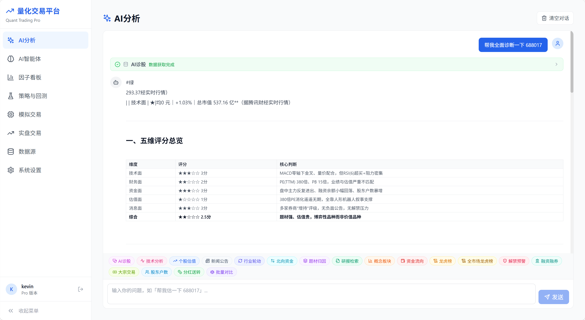 | 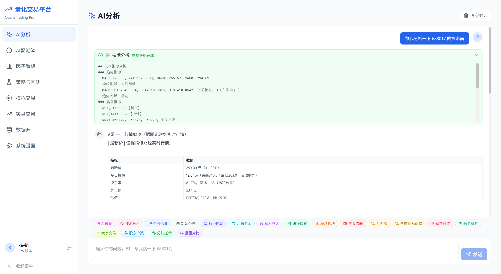 | 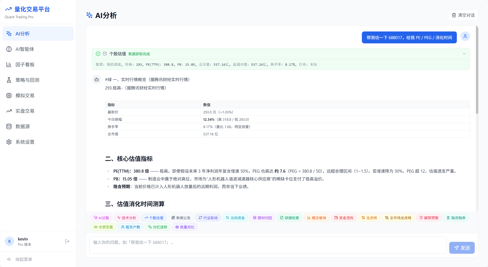 |

| 新闻公告 | 行业轮动 | 北向资金 |
|---|---|---|
| 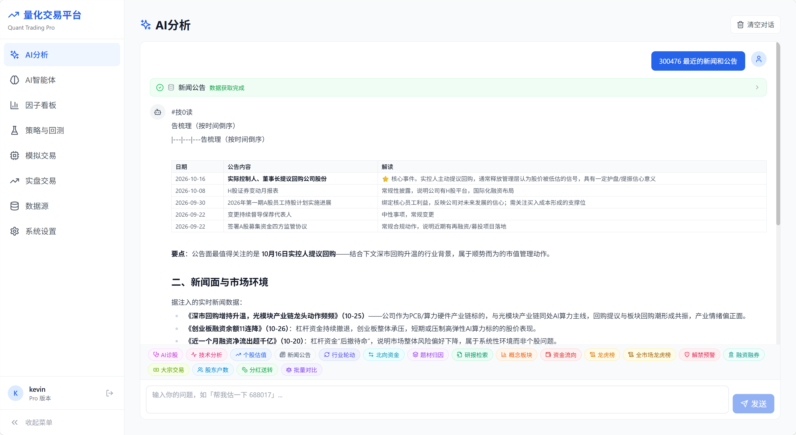 | 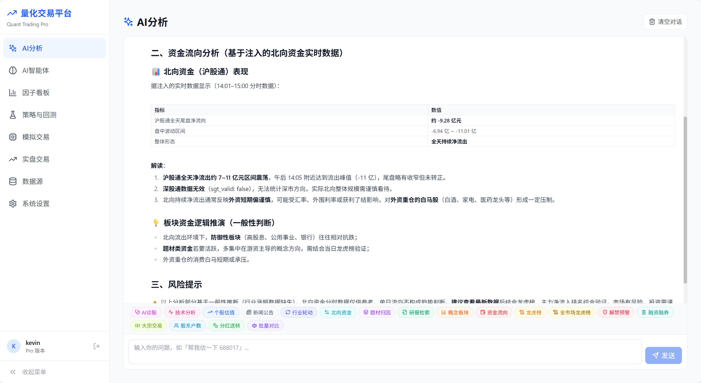 | 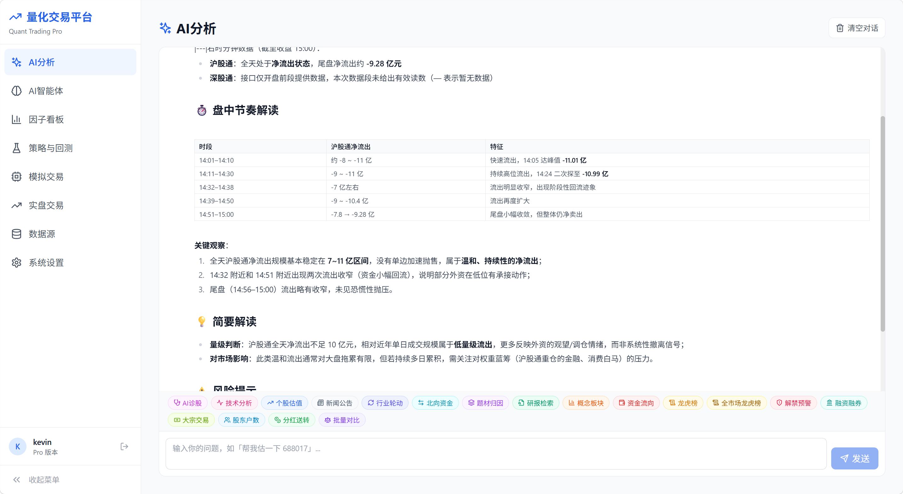 |

| 题材归因 | 研报检索 | 概念板块 |
|---|---|---|
| 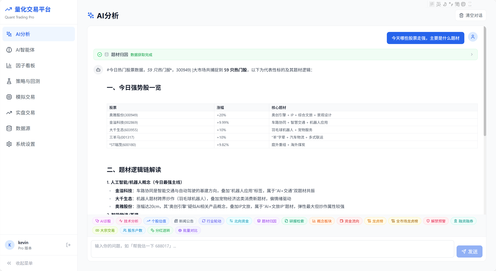 | 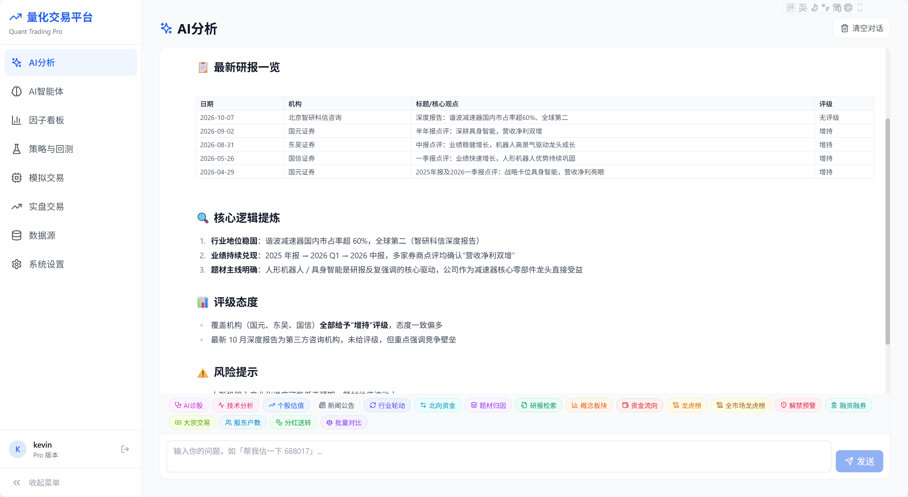 | 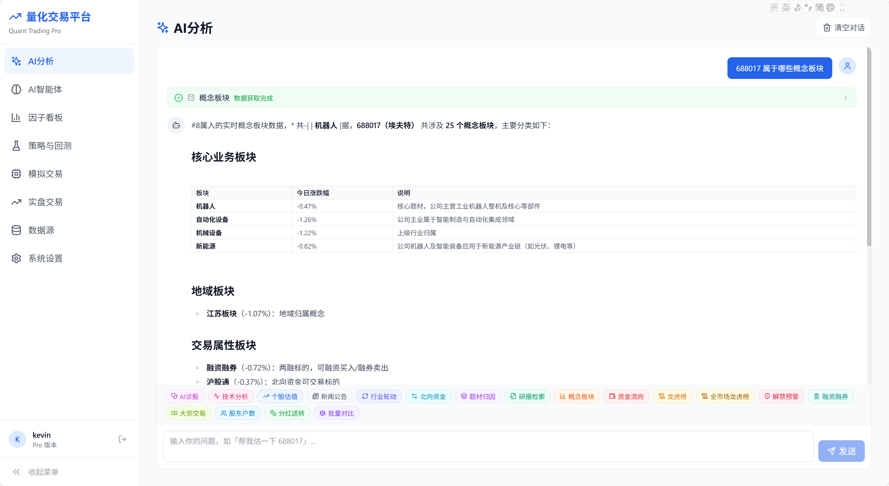 |

| 资金流向 | 全市场龙虎榜 | 融资融券 |
|---|---|---|
| 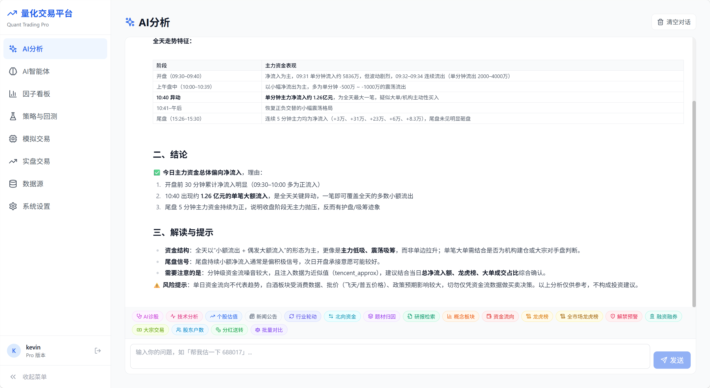 | 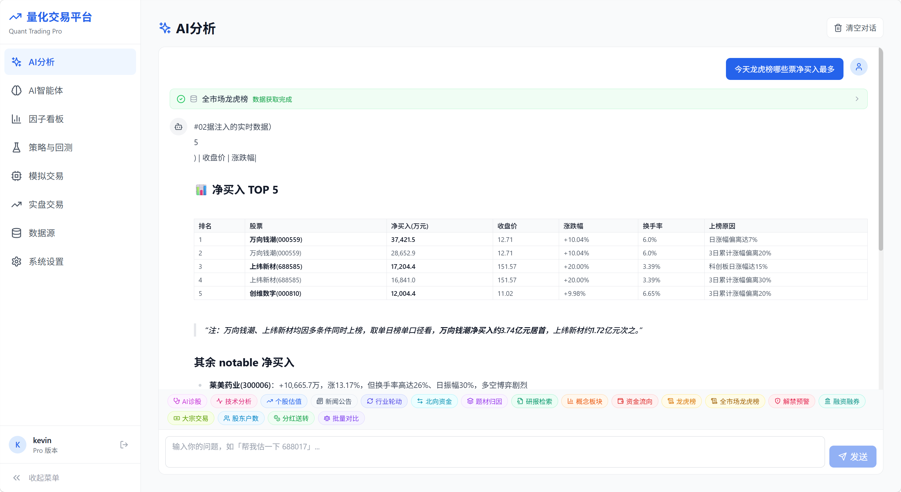 | 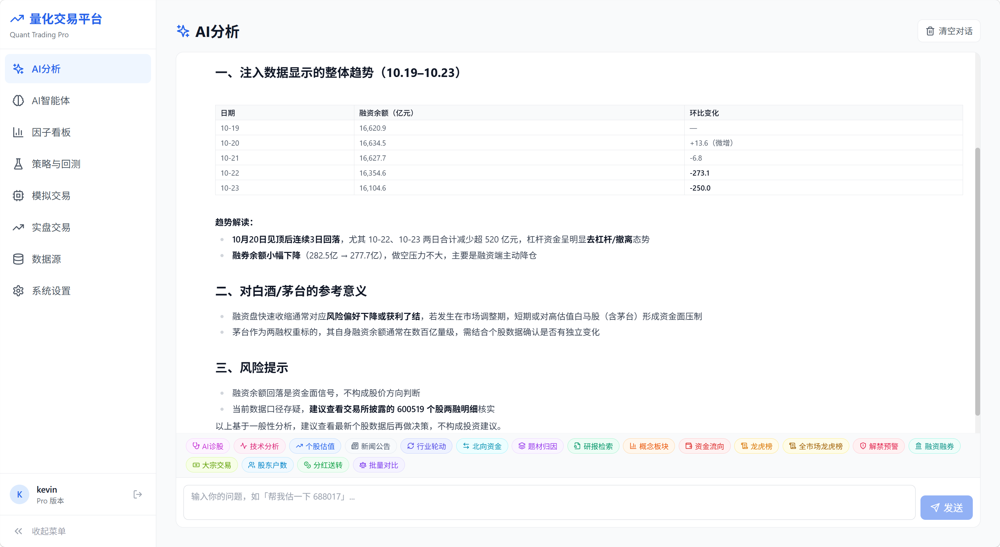 |

> 另含：大宗交易、股东户数、分红送转、批量对比等场景截图，见 [`docs/screenshots/`](docs/screenshots)。

### AI 智能体 · 因子看板 · 策略与回测 · 模拟/实盘

| AI 智能体（选股 + 盯盘） | 因子看板（402 因子） |
|---|---|
| 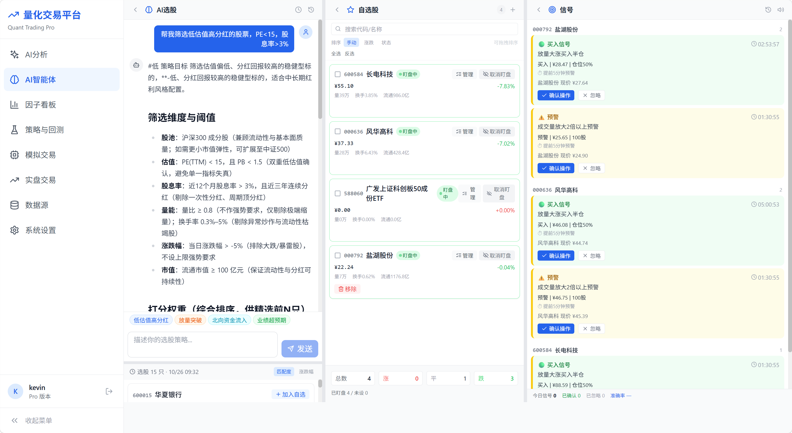 | 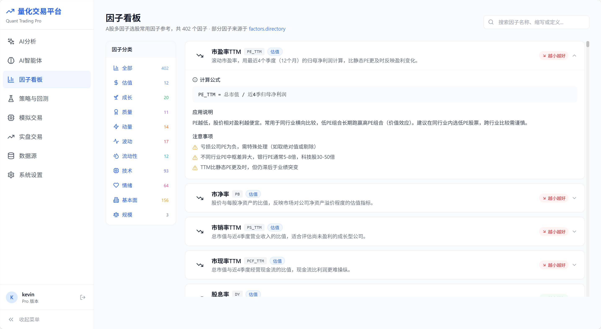 |

| 策略与回测（AI 生成策略代码） | 模拟交易 |
|---|---|
| 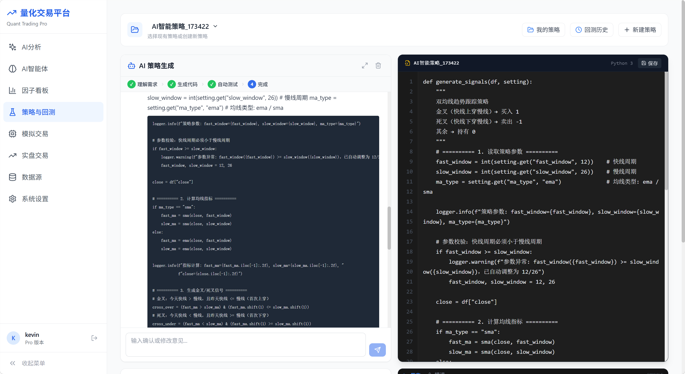 | 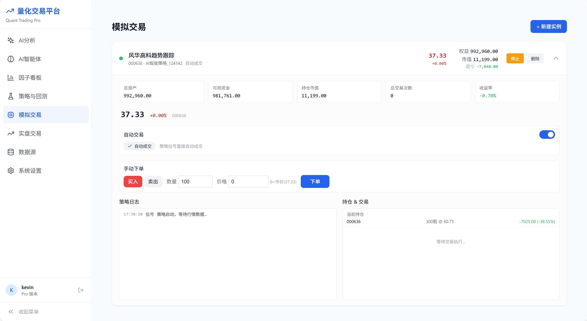 |

| 实盘交易 | 数据源监控 |
|---|---|
| 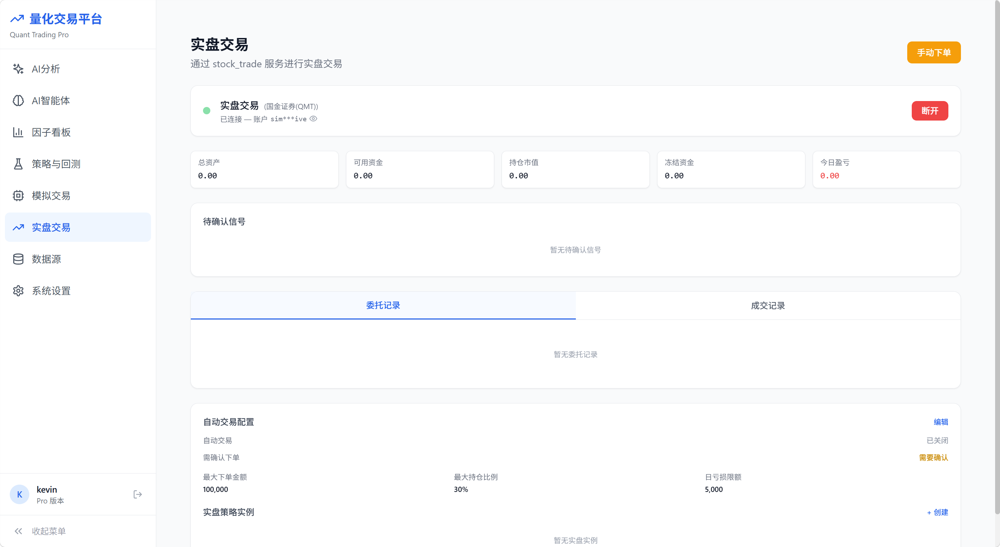 | 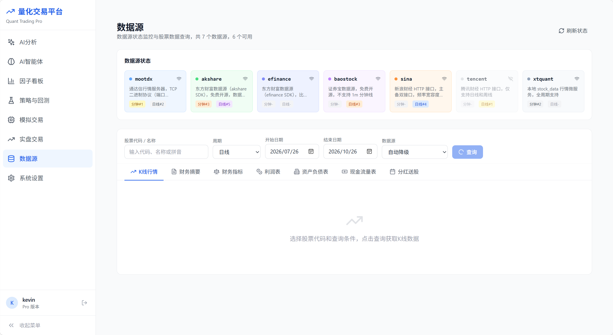 |

---

## ✨ 核心能力

### 1. AI 分析（对话式研报）

- **18 个研报场景**：AI 诊股、技术分析、个股估值、新闻公告、行业轮动、北向资金、题材归因、研报检索、概念板块、资金流向、龙虎榜、全市场龙虎榜、解禁预警、融资融券、大宗交易、股东户数、分红送转、批量对比；
- **结构化输出**：五维评分表、指标表格、风险提示、板块逻辑推演，而非泛泛而谈的"看多/看空"；
- **流式输出**：SSE 实时回显，附带"数据获取 → 分析 → 完成"的过程卡片；
- **多数据源直连**：mootdx / 腾讯 / 东财 / 同花顺 / 巨潮 / 百度 等 28 个公开端点，内置东财接口限流防封。

### 2. AI 智能体（选股 + 盯盘 + 信号）

- **自然语言选股**：把"帮我筛选低估值高分红的股票，PE<15，股息率>3%"翻译成结构化筛选条件，
  在沪深 300 / 上证 50 / 科创 50 成分股中打分匹配，输出候选清单与匹配度；
- **AI 选股优化**：自动补全缺失阈值、给出策略假设并可二次迭代；
- **盯盘规则**：自然语言 → 结构化规则（条件 → 动作），交易时段每分钟评估实时行情生成信号；
- **信号闭环**：买入信号 / 预警 → 人工确认或忽略 → 推送至信号中心（WebSocket 实时）。

### 3. 因子看板

- 402 个 A 股常用因子，按 **估值 / 成长 / 质量 / 动量 / 波动 / 流动性 / 技术 / 情绪 / 基本面 / 规模** 分类；
- 每个因子给出计算公式、应用说明、注意事项与"越大越好 / 越小越好"方向；
- 部分因子来源标注 `factors.directory` 并附外链。

### 4. 策略与回测

- **AI 策略生成**：自然语言 → Python 策略代码（`generate_signals`），内置自动测试与沙箱执行；
- **自建 CTA 回测引擎**（基于 vnpy 核心对象）：
  - 撮合规则：bar[i] 收盘出信号 → bar[i+1] 以开盘价成交
  - T+1 限制、涨跌停校验、佣金（最低 5 元）+ 印花税（0.1%）
  - 多周期：1m / 5m / 15m / 30m / 1h / 1d / 1w / 1mon
  - 沪深 300 基准对比 + 5 项验算（资金守恒、逐日盈亏、权益曲线、最大回撤、交易盈亏）
- **内置策略模板**：双均线、MACD、布林带、ATR 通道、双推力、网格、考夫曼自适应均线、RSI。

### 5. 模拟交易 / 实盘交易

- **模拟盘**：策略实例实时运行、信号流、手动下单、持仓与权益曲线；
- **实盘**：对接 `stock_trade` 微服务，支持 **QMT / XTP（长江·中泰·东方·财通·华鑫·国盛·粤开）/ 华泰 htquant / 同花顺 iFinD / 国泰君安 tquant / 恒生 PTrade**；
- **风控**：单笔最大金额、最大持仓比例、日内亏损限额、信号需人工确认。

### 6. 数据源治理

- 7 个数据源统一抽象，按周期自动降级：**mootdx → xtquant → tencent → baostock → sina → akshare → efinance**；
- 数据源健康状态实时监控（可用性、延迟、支持周期、优先级一目了然）；
- 行情、财报、研报、公告、信号、资金流一站式查询。

---

## 🏗 系统架构

```
┌───────────────────────────────────────────────────────────────┐
│                Frontend (React 18 + TS + Vite)                │
│   AI分析 · AI智能体 · 因子看板 · 策略与回测 · 模拟盘 · 实盘    │
└───────────────────────────┬───────────────────────────────────┘
                            │ REST + WebSocket(/ws)
┌───────────────────────────▼───────────────────────────────────┐
│                   Backend (FastAPI + vnpy)                    │
│  AI服务(OpenAI兼容) │ 智能体 │ 回测引擎 │ 模拟引擎 │ 交易网关  │
│  数据源路由(7源降级) │ 研究数据服务(28端点) │ 风控 │ 认证(JWT) │
└──────┬───────────────────────────────┬────────────────────────┘
       │ REST/WS                       │ REST/WS
┌──────▼──────────────┐      ┌─────────▼───────────┐
│ stock_data (:8000)  │      │ stock_trade (:8800)  │
│ 行情数据微服务       │      │ 交易微服务           │
│ xtquant/多源回退     │      │ xtquant / 多券商     │
└──────┬──────────────┘      └─────────┬───────────┘
       │                               │
┌──────▼───────────────────────────────▼──────────┐
│        MiniQMT / XTP / 华泰 / 同花顺 / 国泰君安 … │
└──────────────────────────────────────────────────┘

┌──────────────────────────────────────────────────┐
│   stock_filters（独立选股服务）                     │
│   新浪/AKShare 全市场 → 初筛 → 策略扫描 → 钉钉通知   │
└──────────────────────────────────────────────────┘
```

### 仓库结构

```
stock/
├── backend/          # 核心后端 FastAPI（认证/策略/回测/模拟/实盘/AI）
├── frontend/         # Web 前端 React + TS + Vite + Tailwind
├── mobile/           # 移动端 H5（AI 对话/研报）
├── stock_data/       # 行情数据微服务（xtquant 封装 + 定时同步）
├── stock_trade/      # 交易微服务（xtquant 封装 + 多券商网关）
├── stock_filters/    # 智能选股服务（多策略扫描 + 钉钉推送）
├── docs/             # 技术文档 + 界面截图
├── ecosystem.config.cjs   # pm2 部署配置
└── TECHNICAL_DOCUMENTATION.md  # 完整技术文档
```

> 说明：`backend/`、`frontend/`、`mobile/`、`stock_data/`、`stock_trade/`、`stock_filters/`
> 早期是各自独立的仓库，现已合并为单一仓库统一维护；各子项目原有的 Git 历史保留在
> `*/.git.codeup-backup/`（已忽略，不会上传），如需回溯可随时取回。

---

## 🧰 技术栈

| 层 | 技术 |
|---|---|
| 前端 | React 18 · TypeScript 5.2 · Vite 5 · Tailwind CSS 3 · Zustand · lightweight-charts · Recharts · Lucide |
| 后端 | FastAPI 0.115 · Uvicorn · SQLAlchemy 2.0 · Pydantic 2.10 · JWT(jose) + bcrypt · WebSocket |
| 量化引擎 | vnpy 4.3（回测 / 网关 / 事件引擎）· Polars · httpx · openai SDK |
| 数据源 | xtquant(MiniQMT) · mootdx · AKShare · Baostock · Efinance · 新浪 · 腾讯 · 东财 · 同花顺 · 巨潮 |
| 交易通道 | QMT · XTP · 华泰 htquant · 同花顺 iFinD · 国泰君安 tquant · 恒生 PTrade |
| 调度/通知 | APScheduler · 钉钉机器人（加签） |

---

## 🚀 快速开始

### 环境要求

- Python 3.10+（后端/微服务）、Node.js 18+（前端）
- 可选：Windows + MiniQMT（极简模式）用于本地行情与实盘；纯公开数据源也能跑通大部分功能

### 1. 启动后端

```bash
cd backend
python -m venv venv
# Windows: venv\Scripts\activate   |  Linux/macOS: source venv/bin/activate
pip install -r requirements.txt

cp .env.example .env        # 按需填写 LLM / 数据库 / 微服务地址
python -m uvicorn app.main:app --host 0.0.0.0 --port 8000
```

接口文档：<http://127.0.0.1:8000/docs>

### 2. 启动前端

```bash
cd frontend
npm install
npm run dev        # 开发模式 http://127.0.0.1:5173
npm run build && npm run preview   # 生产预览
```

前端通过 Vite 代理把 `/api`、`/ws` 转发到后端（端口可用环境变量 `STOCK_BACKEND_PORT` 覆盖）。

### 3. 可选：行情 / 交易 / 选股微服务

```bash
cd stock_data  && pip install -r requirements.txt && python main.py   # :8000
cd stock_trade && pip install -r requirements.txt && python main.py   # :8800
cd stock_filters && pip install -r requirements.txt && python main.py --schedule
```

`stock_filters` 命令行：

| 参数 | 说明 |
|---|---|
| `--schedule` | 启动定时调度（工作日 14:15 初筛，14:28 策略扫描 + 钉钉通知） |
| `--run-screener` | 手动执行初筛 |
| `--run-strategies` | 手动执行策略扫描 |
| `--run` | 手动执行完整流程 |
| `--force` | 忽略缓存强制刷新 |

### 4. pm2 常驻部署（Windows / Linux）

```bash
pm2 start ecosystem.config.cjs
pm2 save          # 保存进程列表（配合 pm2 startup 实现开机自启）
pm2 logs          # 查看日志
pm2 restart all   # 改完代码重启
```

端口可通过环境变量覆盖：`STOCK_BACKEND_PORT`（默认 8010）、`STOCK_FRONTEND_PORT`（默认 4175）。

---

## ⚙️ 配置说明

### backend（`backend/.env`）

| 变量 | 默认值 | 说明 |
|---|---|---|
| `DATABASE_URL` | `sqlite:///./stock_quant.db` | 数据库连接串，生产建议 MySQL |
| `JWT_SECRET_KEY` | 占位符 | **生产必须改为随机字符串** |
| `LLM_API_KEY` / `LLM_BASE_URL` / `LLM_MODEL` | 空 | 任何 OpenAI 兼容网关（DeepSeek / GLM / 通义 / vLLM / Ollama 均可） |
| `STOCK_DATA_URL` / `STOCK_DATA_API_KEY` | `http://localhost:8000` | 行情微服务 |
| `STOCK_TRADE_URL` / `STOCK_TRADE_API_KEY` | `http://localhost:8800` | 交易微服务 |
| `DATA_SOURCE` | `auto` | `auto`/`mootdx`/`akshare`/`baostock`/`xtquant`/`tencent`/`sina`/`efinance` |
| `MARKET_BACKEND` | `akshare` | 行情后端选择 |
| `TRADE_BACKEND` | `sim` | `sim`（模拟）/ `stock_trade`（实盘） |
| `BROKER` | `qmt` | 券商通道选择 |
| `TRADE_AUTO_CONNECT` | `false` | 启动时自动连接交易网关 |

### 其它服务

| 变量 | 服务 | 说明 |
|---|---|---|
| `STOCK_DATA_API_KEY` | stock_data | 行情微服务 API Key（`X-API-Key`） |
| `STOCK_TRADE_API_KEY` | stock_trade | 交易微服务 API Key（`X-API-Key`） |
| `QMT_DATA_DIR` / `QMT_APP_DIR` | stock_data | 本地 QMT 数据目录 / 程序目录 |
| `QMT_PATH` | stock_trade | 本地 QMT 客户端路径 |
| `DINGTALK_WEBHOOK` / `DINGTALK_SECRET` | stock_filters | 钉钉机器人（正式） |
| `DINGTALK_TEST_WEBHOOK` / `DINGTALK_TEST_SECRET` | stock_filters | 钉钉机器人（测试） |

每个目录都提供了 `.env.example` 模板；真实密钥请写入 `.env` / `.env.local`（已在 `.gitignore` 中）。

> 本机私有配置（QMT 路径、钉钉机器人等）统一放在仓库根目录的 `.env.local`，该文件已被忽略：
> ```bash
> set -a; source .env.local; set +a   # Git Bash / WSL
> ```

---

## 🔐 安全与脱敏

本仓库在发布前已完成**脱敏处理**，可直接公开：

| 风险项 | 处理方式 |
|---|---|
| 数据库密码（明文写在代码/compose 文件） | 已移除，改为 `DATABASE_URL` 环境变量，默认本地 SQLite |
| LLM API Key | 已从代码移除，仅存在于被忽略的 `backend/.env` |
| 钉钉机器人 webhook / 加签密钥 | 已从 `config.yaml` 清空，改为环境变量注入 |
| 本机券商安装路径 | 已抽成 `QMT_PATH` / `QMT_DATA_DIR` 等环境变量 |
| 本地数据库（用户、持仓、订单） | `*.db` / `stock_quant.db` 已加入 `.gitignore` |
| 日志、虚拟环境、node_modules、构建产物 | 已加入 `.gitignore` |
| 私有网段 / 内网地址 | 测试脚本中的示例地址已泛化 |

> 如果你 fork 后需要接入自己的行情/交易账号，请**只**通过环境变量配置，并确认 `.env` 未被 `git add`。
> 建议提交前执行 `git grep -nE "password|api[_-]?key|secret|access_token" -- ':!*.example'` 自查。

---

## 📚 文档

- [`TECHNICAL_DOCUMENTATION.md`](TECHNICAL_DOCUMENTATION.md) —— 完整技术文档：架构、模块、API 汇总、数据库设计、策略体系、部署拓扑
- [`backend/SKILL.md`](backend/SKILL.md) —— A 股全栈数据工具包（七层数据源、28 个端点的调用说明与防封策略）
- [`stock_data/README.md`](stock_data/README.md) / [`stock_trade/README.md`](stock_trade/README.md) / [`stock_filters/README.md`](stock_filters/README.md) —— 各微服务说明

---

## 📄 License

[MIT](LICENSE) © 2026 Neo

> 本项目的数据均来自公开渠道，请遵守各数据源的使用条款；实盘交易风险自担。
